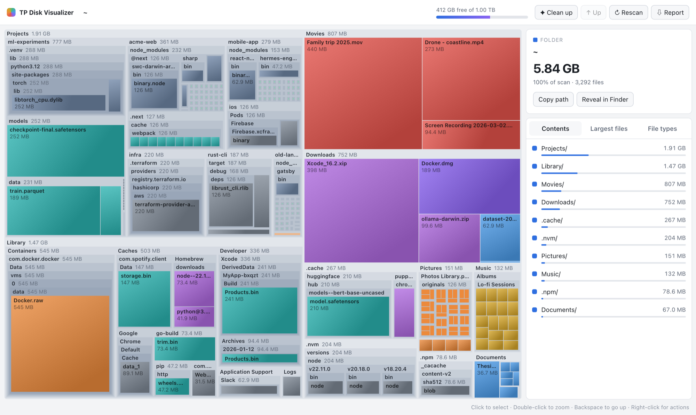
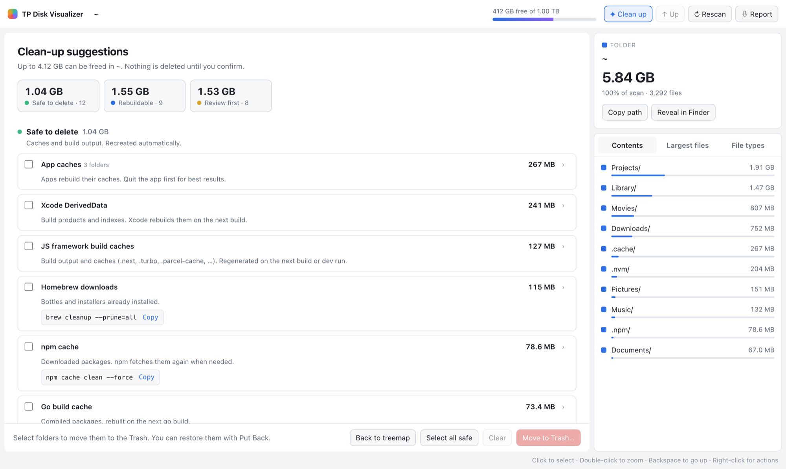

# tpdv — TP Disk Visualizer

**[Website](https://ratan99.github.io/tp-disk-visualizer/) · [Live demo](https://ratan99.github.io/tp-disk-visualizer/demo.html) · [Install](#install)**

<picture>
  <source media="(prefers-color-scheme: dark)" srcset="docs/assets/treemap-dark.png">
  
</picture>

A fast disk-space visualizer for macOS. It's a single CLI binary that scans
a folder, then shows an interactive treemap in your browser. From there you
can drill down, find the biggest files, and move things to the Trash. It
can also write a self-contained HTML report you can share.

```
tpdv                         # scan ~ and open the browser UI
tpdv /                       # whole disk
tpdv ~/Library               # any folder
tpdv report ~ -open          # write tpdv-report-<date>.html and open it
tpdv top ~/Downloads -n 30   # terminal-only summary
tpdv suggest                 # caches & build folders you can clean (deletes nothing)
```

## Install

Needs Go 1.22+. No cgo or Xcode toolchain required.

```bash
go install github.com/ratan99/tp-disk-visualizer/cmd/tpdv@latest
```

Or from a clone:

```bash
git clone https://github.com/ratan99/tp-disk-visualizer
cd tp-disk-visualizer
make install        # builds and copies to ~/.local/bin/tpdv (PREFIX=/usr/local to change)
make universal      # arm64 + amd64 fat binary in bin/tpdv
```

## Browser UI

- **Treemap**: nested squarified layout, colored by file type (video,
  images, archives, disk images, code, documents, data/ML models, …).
- **Navigate**: double-click a folder to zoom in. Backspace, the breadcrumbs
  or ↑ Up go back out. Hover shows a tooltip.
- **Side panel**: the selected item's details, plus *Contents*, *Largest
  files* (within the current folder) and *File types* tabs.
- **Actions** (right-click or the panel): Reveal in Finder, Open, Copy path,
  Rescan, and **Move to Trash**. Trash goes through Finder, so *Put Back*
  works. You confirm every move, and system locations such as `/`, `~`,
  `~/Library`, `/System` and `/usr` are refused on the server side.
- **⇩ Report** downloads an HTML snapshot of the current state.
- Free disk space and "Freed …" are shown in the header.

## Clean-up suggestions

**✦ Clean up** in the browser, or `tpdv suggest` in the terminal, lists
folders you can usually remove, grouped by how safe that is:

<picture>
  <source media="(prefers-color-scheme: dark)" srcset="docs/assets/cleanup-dark.png">
  
</picture>

| level | what | examples |
|---|---|---|
| **Safe** | caches and build output, recreated automatically | `~/Library/Caches/*`, `.next`, `.turbo`, `__pycache__`, Xcode DerivedData, npm / Yarn / Bun / Go build caches, logs |
| **Rebuildable** | recreated by a command; costs time, not data | `node_modules`, `.venv`, Rust / Maven `target`, Gradle `build`, `.terraform`, `Pods`, `~/.gradle/caches`, `~/.m2`, Go module cache, Hugging Face models |
| **Review** | might hold things you want | Docker data, Xcode archives, simulators, old Node / Python / Rust versions, installers in Downloads, Trash, iPhone backups |

How it stays safe:

- **Project folders need a marker file.** `node_modules` counts only next
  to a `package.json`, `target` only next to `Cargo.toml` or `pom.xml`,
  `build` only next to a Gradle file, `.venv` only if it contains
  `pyvenv.cfg`, and `.terraform` only next to `*.tf` files. A `build/`
  folder full of PDFs is left alone.
- **Nested matches are skipped.** It never looks inside a match, so
  `node_modules` within `node_modules` isn't listed twice.
- **The tool's own command is shown where there is one** (`npm cache clean`,
  `go clean -modcache`, `docker system prune`, `brew cleanup`, …). For
  locations that must not be deleted directly, such as Docker data, the Go
  module cache, simulators and iPhone backups, the UI has no Trash option
  and the server refuses it.
- **Nothing is deleted without confirmation.** You pick items or whole
  groups ("Select all safe" is the quick start), check the paths in the
  confirm dialog, and they go to the Trash in a single Finder call, so Put
  Back works.
- **It shows how old each project is**, based on the marker file's
  modification time, so you can spot stale ones.

Rules live in [`internal/clean/rules.go`](internal/clean/rules.go), with
macOS-specific locations in `rules_darwin.go`. To add one, write a
`byName(...)` or `atPath(...)` entry with a title, a safety level and a
one-line why.

## Security

The server listens only on `127.0.0.1`. Every request needs the random
token in the launch URL, and the `Host` header is checked, so other
websites can't call the API.

## Why it's fast

- **`getattrlistbulk(2)`** returns names, types and allocated sizes for a
  whole batch of directory entries in one syscall. That replaces a
  `readdir` plus one `lstat` per file. It's called straight from libSystem
  through an assembly trampoline, so there's no cgo.
- **Parallel walk**: subfolders are handed to idle workers (2×CPU by
  default), and a folder is read inline when all workers are busy.
- **Compact tree**: files under `-min-file` (256 KB by default) are counted
  but not stored one by one. Each folder keeps a "N small files" total, so
  memory stays flat on trees with millions of files. Sizes stay exact.
- **Sized like Finder and `du`**: it reports allocated bytes (sparse files
  count what they really use), counts hard links once, skips symlinks, and
  doesn't double-count `/System/Volumes/Data` firmlinks when scanning `/`.
- **Lean payloads**: the browser only receives items big enough to draw at
  the current zoom level. Everything else is merged into "N smaller items".

Measured on an Apple Silicon MacBook, a developer folder with 3.0M files
and 73 GB (warm cache):

| tool | time |
|---|---|
| `du -sk` | 71.7 s |
| tpdv, readdir + lstat (`TPDV_STD=1`) | 25.5 s |
| **tpdv, getattrlistbulk** | **15.7 s** |

Totals match `du` exactly.

## Flags

| flag | meaning |
|---|---|
| `-workers N` | parallel directory readers (default 2×CPU) |
| `-min-file SZ` | group files smaller than this (default `256K`, `0` keeps all) |
| `-one-fs` | don't cross into other mounted filesystems |
| `-exclude a,b` | skip these paths |
| `-port N`, `-no-open` | ui: fixed port, don't launch the browser |
| `-o FILE`, `-open` | report: output path, open when done |
| `-n N` | rows in the terminal summary (per group for `suggest`) |

Some folders can't be read without permission. To include them, grant your
terminal **Full Disk Access** (System Settings → Privacy & Security).

## Layout

```
cmd/tpdv/main.go           CLI (ui / report / top / suggest)
internal/scan/             parallel scanner + tree (platform readers per OS)
internal/clean/            clean-up rules and finder (rules_<os>.go per platform)
  readdir_darwin.go        getattrlistbulk reader
  bulk_darwin*.{go,s}      libSystem trampoline
  readdir_std.go           portable readdir+lstat reader (Linux, fallback)
internal/app/              HTTP server, actions, report, terminal summary
  platform_darwin.go       Finder trash / reveal / open
web/index.html             the whole UI (canvas treemap, no dependencies)
```

## Other operating systems

Linux already builds and scans with the portable reader. Trash and Reveal
are stubbed in `internal/app/platform_other.go`. Windows needs:

- a `readdir_windows.go` using `FindFirstFileExW` with
  `FIND_FIRST_EX_LARGE_FETCH`
- `disk_windows.go`
- a `platform_windows.go` that uses the Shell API to move files to the
  Recycle Bin

## Screenshots and demo

The screenshots, [`docs/demo.html`](docs/demo.html) and the landing page
images all come from a made-up home folder, so they show no real files.
To regenerate them (needs Google Chrome; writes about 3.5 GB of filler to
`/tmp/tpdv-demo` and deletes it afterwards):

```bash
make screenshots
```

The landing page is `docs/index.html`, served by GitHub Pages from `docs/`.

## License

MIT, see [LICENSE](LICENSE).
